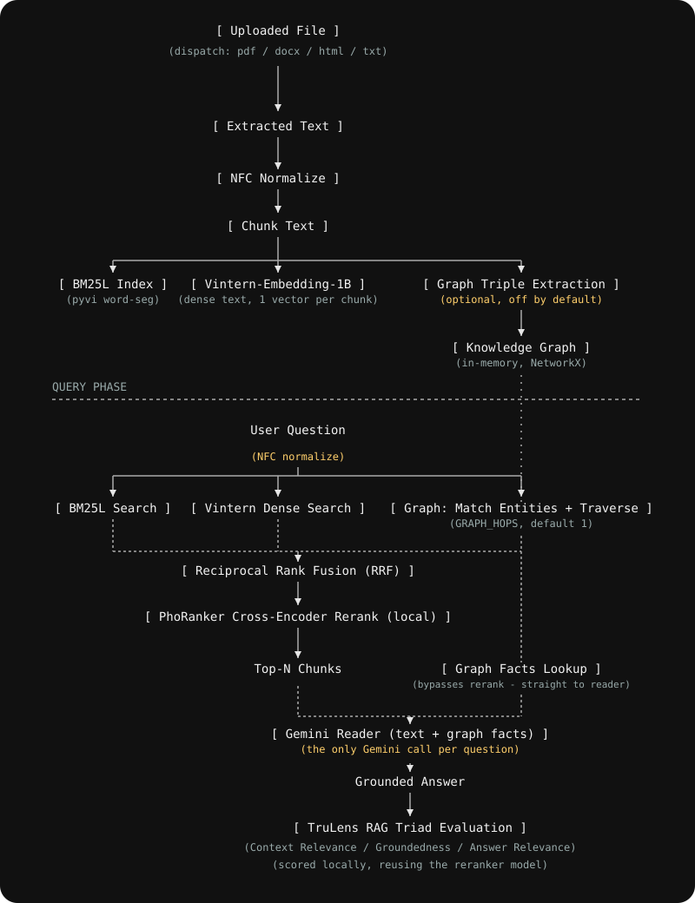

# Vietnamese RAG

A web app for asking questions over your own documents (PDF, DOCX, HTML, text) in Vietnamese, built around a hybrid retrieval pipeline tuned for Vietnamese.

Upload files on the left, ask questions in the chat on the right. Answers are grounded in the retrieved context, with sources and a TruLens-style RAG Triad evaluation (Context Relevance / Groundedness / Answer Relevance) shown per answer.

## Architecture



- **Text retrieval**: BM25L over pyvi word-segmented text, fused via LangChain's `EnsembleRetriever` (real RRF) with Vintern-Embedding-1B dense search (its per-token vectors are mean-pooled into one vector per chunk to keep memory low).
- **Reranking**: the fused candidates are reranked locally by `itdainb/PhoRanker`, a Vietnamese-specific cross-encoder (~100M params) — no API call. It beats the general multilingual `bge-reranker-v2-m3` (568M params, the original default here) on Vietnamese benchmarks while being ~5.6x smaller and ~4x faster — both lighter and better for this project, not the usual trade-off.
- **Generation**: Gemini answers using the top reranked text chunks (plus knowledge-graph facts when GraphRAG is on) — **the only API call per question.**
- **Evaluation**: every answer is scored with a TruLens-style RAG Triad (context relevance, groundedness, answer relevance, composite), computed locally by reusing the same reranker model as a (context, answer) / (query, answer) scorer instead of a separate LLM judge — see the trade-off note in `knowledge_base.py::_evaluate_triad_locally`.

This pipeline (and the underlying `rag/` modules) originated as a CLI demo at `/Users/bill/code/RAG-full`; this project wraps it in a FastAPI backend + React frontend and adds multi-format ingestion, incremental indexing, and persistence.

## Project layout

```
backend/
  app/
    main.py           FastAPI app, CORS, static file serving, startup (rebuild index from DB)
    config.py          env-driven settings
    db.py               SQLite schema + queries (documents, chunks, triples, messages)
    knowledge_base.py   incremental index wrapping rag/ (add/rebuild/retrieve/generate/query)
    models.py            Pydantic request/response schemas
    ingestion/
      extractors.py       PDF/DOCX/HTML/TXT → text pages
      normalize.py         NFC Unicode normalization
    rag/                  retrieval modules (BM25L, Vintern text embeddings, graph store, local_reranker)
    routers/
      documents.py         upload / list / delete
      chat.py               ask / history
  requirements.txt
  .env.example
data/
  rag.db                SQLite database (source of truth for chunks/triples/messages)
  uploads/<doc_id>/     original uploaded file
frontend/
  src/
    api.ts                 fetch wrappers
    types.ts
    components/
      UploadPanel.tsx        drag/drop upload + document list
      ChatWindow.tsx          message list + input
      MessageBubble.tsx        answer, sources, triad score bars
```

## Quick start (single command)

Once the backend venv and `backend/.env` are set up (see below), run from the project root:

```bash
./start.sh
```

This builds the frontend into `frontend/dist` (only when sources changed) and starts the backend, which serves both the web app and the API at `http://localhost:8000`. Override with `PORT=9000 ./start.sh`; extra args go to uvicorn (e.g. `./start.sh --reload`). For frontend hot reload during development, use the two-process setup below instead.

## Setup

### Backend

```bash
cd backend
python3 -m venv .venv
source .venv/bin/activate
pip install -r requirements.txt
cp .env.example .env   # then set GEMINI_API_KEY (https://aistudio.google.com/)
uvicorn app.main:app --reload
```

Runs on `http://localhost:8000`. First upload/query will download Vintern-Embedding-1B (~1.8GB) and the `PhoRanker` reranker (~520MB) from Hugging Face if not already cached; both run locally afterward and are always loaded. Only Vintern's text path is kept in memory: its image encoder and text-generation head (~0.9GB of the ~1.9GB download) are dropped right after loading, since text embedding never uses them. Only answer generation calls the Gemini API — **1 request per question** (set `ENABLE_TRIAD_EVAL=false` to skip local triad scoring too, if you don't need it).

### Frontend

```bash
cd frontend
npm install
npm run dev
```

Runs on `http://localhost:5173` and proxies `/api/*` to the backend.

## Supported inputs

`.pdf`, `.docx` (not legacy `.doc`), `.html`/`.htm`, `.txt`/`.md`

## API

| Method | Path | Description |
|---|---|---|
| `POST` | `/documents` | Upload + extract + index a file (multipart, field `file`) |
| `GET` | `/documents` | List uploaded documents and their status |
| `DELETE` | `/documents/{id}` | Remove a document and rebuild the index |
| `POST` | `/chat` | `{"question": "..."}` → answer + sources + triad scores |
| `GET` | `/chat/history` | Past chat messages |

## Known limitations (v1)

- **Memory-hungry**: this keeps Vintern-Embedding-1B's text path (~1GB) and PhoRanker (~260MB at bfloat16) resident for the life of the backend process. On a memory-constrained machine, that alone can push the OS into swapping, which makes every local model call (retrieval, reranking, triad eval) dramatically slower - sometimes minutes instead of seconds. If things get sluggish, check `sysctl vm.swapusage` (macOS) before assuming it's a code bug, and close other memory-heavy apps.
- **`rebuild_from_db()` re-embeds the entire stored corpus on every restart** (no vector persistence) in fixed batches of `EMBED_BATCH_SIZE` chunks (default 16) - batching bounds peak memory per forward pass, but a large corpus on a memory-constrained machine can still make a restart take minutes.
- Single shared knowledge base — no multi-user auth or separate collections.
- Embeddings are recomputed from SQLite-stored text on every server restart (no vector persistence) — fine at prototype scale, adds a one-time delay proportional to how much you've uploaded.
- No OCR / diacritic restoration for scanned or photographed Vietnamese text.
- No streaming chat responses.
- Requests are serialized through a single lock around the retrieval/embedding models (they aren't thread-safe on GPU/MPS), so this is built for one user at a time, not concurrent traffic.
